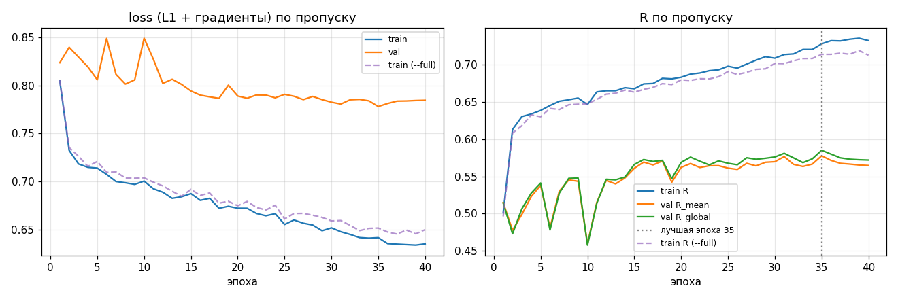
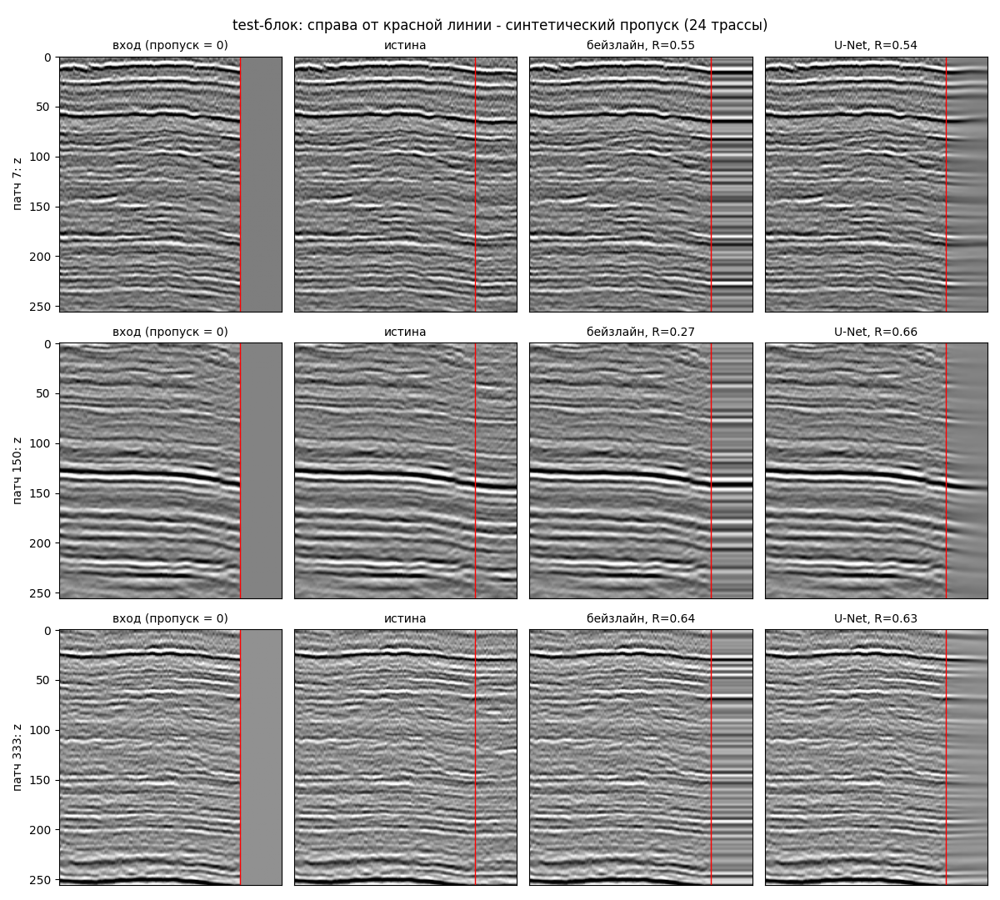
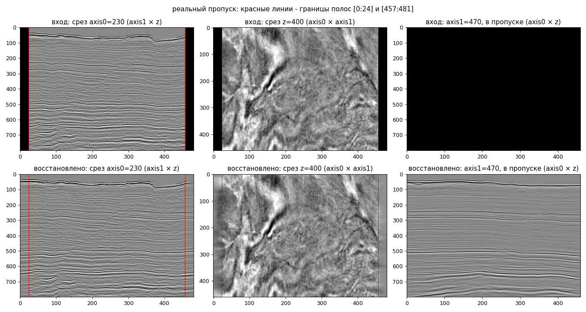
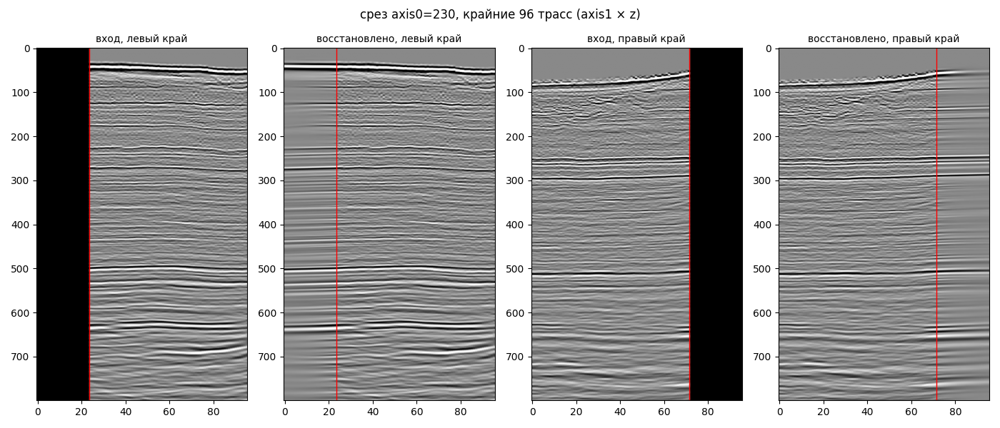
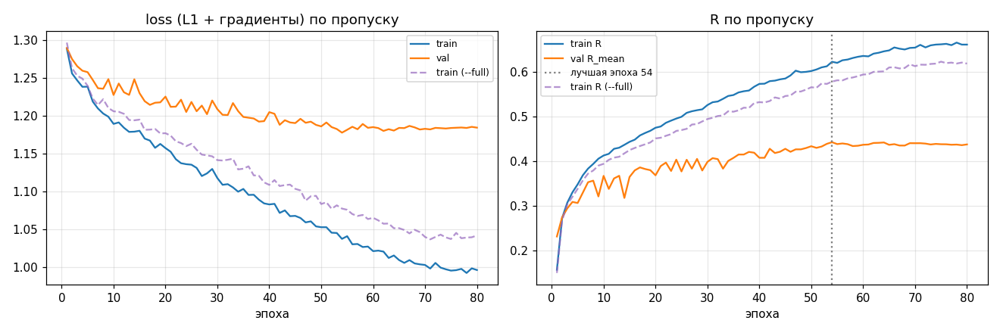
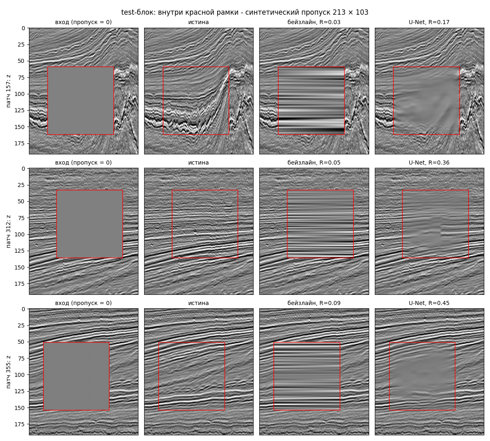
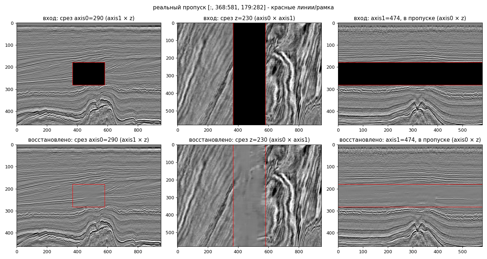
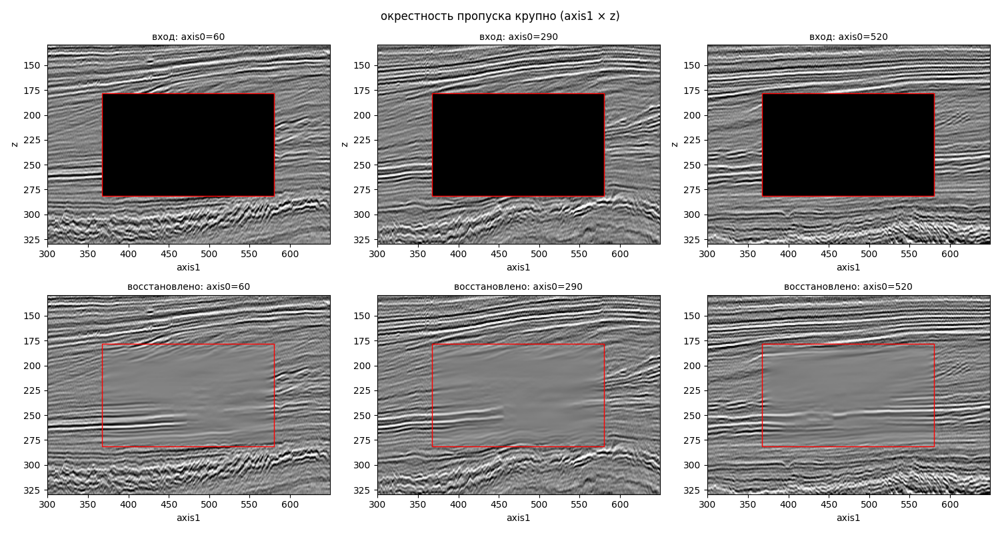

# cv_seysmorazvedka - Восстановление сейсмокубов

## 1. Задача и данные

Нужно восстановить скрытые участки двух сейсмокубов. Для обучения разрешено использовать только известную часть того же куба. Качество оценивается по R — коэффициенту корреляции Пирсона на восстановленных участках.

| куб         | размер          | пропуск                                                    | доля скрытого |
|-------------|-----------------|------------------------------------------------------------|---------------|
| inpainting  | 580 × 951 × 462 | `[:, 368:581, 179:282]` — «туннель» через весь axis0       | ~5%           |
| outpainting | 460 × 481 × 800 | `[:, 0:24, :]` и `[:, 457:481, :]` — полосы по краям axis1 | ~10%          |

- SHA-256 обоих `.npy` совпадают с указанными в задании.
- Значения — float32, нормированы min-max (среднее ≈ 0.5). Пропуски заполнены точными нулями.
- Оси: axis0 и axis1 — латеральные, axis2 — глубина z.

## 2. Подход

### 2.1 Self-supervised датасет
Пары «вход -> ответ» вырезаются из известной части куба. В каждом патче искусственно выбивается пропуск той же формы, что и настоящий; ответ — исходные значения на месте этого пропуска.

- **Inpainting.** Патч 352 × 192 (латераль × z) с прямоугольной дырой 213 × 103 около центра. Положение дыры случайно смещается на ±24 / ±16 отсчетов.
- **Outpainting.** Окно 128 × 256 (латераль × z), скрыты последние 24 трассы справа. Левый край куба на инференсе обрабатывается зеркальным флипом, поэтому одна модель закрывает оба края.
- **Источники плоскостей.** Основные — срезы по axis0, как на инференсе. Для аугментации добавлены срезы по axis1: обе латеральные оси геологически равноправны. Патчи берутся только там, где нет реального пропуска.
- **Аугментации:** флип латерали, флип порядка соседних срезов, масштаб амплитуды ×0.85–1.15.
- **Нормировка:** вычитается среднее и делится на std, оба посчитаны только по известным вокселам.
- **2.5D-вход (k = 5, stride = 2).** К центральному срезу добавляются соседние по axis0 со смещениями −4, −2, +2, +4. Маска пропуска одна на всю стопку, как и у реальной дыры, которая проходит через весь axis0.

### 2.2 Разбиение без утечки
Соседние срезы сильно коррелируют, поэтому выборки разделены блоками по axis0 с зазором не меньше 4 строк. Этого хватает и для 2.5D-входа с k = 5, stride = 2.

| куб         | train | val     | test    |
|-------------|-------|---------|---------|
| inpainting  | 0–399 | 416–495 | 500–579 |
| outpainting | 0–319 | 336–395 | 400–459 |

- В каждую эпоху случайно берется 3000 обучающих патчей.
- Для val и test зафиксированы по 400 патчей, одинаковые для всех моделей.

### 2.3 Модель
U-Net: 4 уровня, base = 32, блоки DoubleConv (Conv–BN–ReLU × 2).
- Вход — k срезов, в которых пропуск обнулён, плюс маска пропуска.
- Выход — центральный срез. Известные значения затем берутся из входа, а модель заполняет только пропуск.
- Апсемплинг в декодере: `transpose` (ConvTranspose2d) или `upsample` (билинейная интерполяция + свертка 3×3, без шахматных артефактов).
- 7.8 млн параметров (k = 1, transpose), 8.6 млн (k = 5, upsample).

### 2.4 Обучение
- **Loss:** L1 по пропуску + 0.5 · L1 разницы градиентов по z и по латерали. R в loss не используется — только как метрика.
- **Оптимизация:** AdamW (lr = 1e-3, weight decay = 1e-4), OneCycleLR, batch 16, fp32. В fp16 на GTX 1660 Ti получались NaN.
- **Выбор эпохи и варианта** — по val R. Test используется только для отчёта.
- **Финальная модель** (`--full`) обучается на всех строках axis0 с тем же числом эпох; сохраняется последняя эпоха.

### 2.5 GAN (pix2pix-стиль)
- Генератор — U-Net, инициализированный весами лучшего U-Net.
- Дискриминатор — PatchGAN со spectral norm, hinge loss.
- Loss генератора: L1-часть U-Net + λ · adversarial, λ = 0.01 или 0.1.
- Оптимизатор Adam: lr_G = 1e-4, lr_D = 2e-4.

### 2.6 Инференс
- Каждый срез axis0 обрабатывается в окне вокруг пропуска, предсказание вставляется только в пропуск.
- TTA: флип порядка соседних срезов (при k > 1) и флип латерали (только для inpainting — для outpainting маска при этом флипе несимметрична).
- `infer.py` проверяет результат: размер совпадает со входом, нет NaN и inf, известные значения не изменены (бит в бит), в пропуске не осталось нулей.

### 2.7 Метрики (`compare.py`)
- **R_mean** — R, посчитанный внутри каждого тестового пропуска и усреднённый по 400 патчам.
- **R_global** — один R по всем вокселам всех тестовых пропусков. Он ближе к тому, как, скорее всего, будет считаться R на восстановленной области куба.
- **adjR** — средний R между соседними срезами axis0 внутри заполненного *реального* пропуска. Рядом для сравнения приводится adjR известной области той же формы. Если adjR пропуска ниже, чем у данных, между срезами есть полосы.
- **std** — разброс значений в заливке реального пропуска относительно соседней известной области. Меньше 1 — заливка бледнее данных.
- **Бейзлайны без обучения.** Inpainting: линейная интерполяция по латерали между краями дыры. Outpainting: копия последней известной трассы.

## 3. Результаты

### 3.1 Outpainting

Тестовый блок, 400 синтетических пропусков:

| модель                      | k     | апсемплинг   | R_mean | R_global | R_mean TTA | R_global TTA | adjR пропуска (данные 0.985) | std      |
|-----------------------------|-------|--------------|--------|----------|------------|--------------|------------------------------|----------|
| бейзлайн: копия края        | —     | —            | 0.473  | 0.467    | —          | —            | 0.987                        | 1.06     |
| U-Net (40 эп.)              | 1     | transpose    | 0.615  | 0.602    | 0.615      | 0.602        | 0.991                        | 0.64     |
| U-Net `_up` (40 эп.)        | 1     | upsample     | 0.609  | 0.598    | 0.609      | 0.598        | 0.991                        | 0.66     |
| **U-Net `_up_k5` (40 эп.)** | **5** | **upsample** | 0.613  | 0.599    | **0.616**  | **0.602**    | 0.994                        | **0.72** |
| GAN λ = 0.01                | 1     | transpose    | 0.613  | 0.601    | 0.613      | 0.601        | 0.990                        | 0.68     |
| GAN λ = 0.1                 | 1     | transpose    | 0.604  | 0.593    | 0.604      | 0.593        | 0.989                        | 0.79     |

Выбор варианта по val R:

| вариант         | лучший val R (эпоха) | val R_global на ней | среднее val R за последние 5 эпох |
|-----------------|----------------------|---------------------|-----------------------------------|
| U-Net transpose | 0.561 (21)           | —                   | 0.554                             |
| `_up`           | 0.566 (32)           | 0.575               | 0.554                             |
| **`_up_k5`**    | **0.578 (35)**       | **0.585**           | **0.567**                         |

**Финальная модель:** `_up_k5` (k = 5, stride = 2, upsample), обучена с `--full` 40 эпох. Это `runs/outpainting_unet_final/final.pt`, ~35 МБ.

Заполненный куб `results/outpainting_restored.npy` проходит все проверки:
- размер (460, 481, 800), тип float32;
- NaN и inf нет;
- известные значения совпадают со входом бит в бит;
- в пропуске не осталось нулей;
- std заливки 0.0202 против 0.0293 у известных данных, отношение ≈ 0.69.

R этого прогона на контрольной выборке (~0.64) — не оценка качества: эти строки входили в обучение. Для отчёта используется test R варианта `_up_k5` из таблицы выше.

#### Обучение `_up_k5`


- Val R выходит на плато к ~20-й эпохе, лучшая эпоха — 35-я.
- Train R продолжает расти, поэтому разрыв train/val увеличивается, но val при этом не падает.
- У финальной модели (пунктир, обучена на всех данных) кривая train почти совпадает с holdout-моделью.

#### Примеры с test-блока
Синтетический пропуск — справа от красной линии. Окна выбраны заранее с фиксированными номерами (7, 150, 333), а не подобраны по качеству.



- Модель продолжает отражающие горизонты в пропуск с их наклоном, а бейзлайн тянет последнюю трассу строго горизонтально. Поэтому на наклонных горизонтах (окно 150) модель сильно выигрывает: R 0.66 против 0.27.
- На окнах 7 и 333 горизонты почти горизонтальные, и копия края даёт R на уровне модели. Преимущество модели — в среднем по 400 окнам: R_global 0.60 против 0.47.

#### Восстановленный куб (реальный пропуск)




- Горизонты продолжаются в обе полосы без разрывов на границе.
- По срезу внутри пропуска (axis1 = 470) видно, что вдоль axis0 заливка согласована и без полос.
- **Слабое место:** чем дальше от известных данных, тем бледнее заливка. У дальнего края полосы видны в основном сильные горизонты. Это то же занижение амплитуды, что показывает std ≈ 0.7: модель с L1 предсказывает «условное среднее».

#### Файлы для сдачи (outpainting)
| файл | что это |
|---|---|
| `outpainting_result.ipynb` | ноутбук по шаблону курса: данные → модель → обучение → тест → инференс → сохранение. Код самодостаточный, `seismic_lib.py` не нужен |
| `models/outpainting_model.pt` | **финальная модель** (веса + `k`, `stride`, `base`, `up_mode`, `norm`), 35 МБ |
| `models/outpainting_model_holdout.pt` | та же модель, обученная только на train, — для честной оценки на test в ноутбуке |
| `models/outpainting_history.json` | история обучения обеих моделей (графики в ноутбуке) |
| `SeismicUtils.py` | визуализация из материалов курса |
| `results/outpainting_restored.npy` | восстановленный куб 460 × 481 × 800, 708 МБ, SHA-256 `1ef4da86…382b58`. В git не хранится: больше лимита GitHub (100 МБ), создаётся ноутбуком или `infer.py` |

Для запуска ноутбука нужен `data/outpainting_cube_missed_data.npy` рядом с ним. По умолчанию `RETRAIN = False`: веса берутся из `models/`, ноутбук выполняется за ~1,5 мин.

### 3.2 Inpainting

Тестовый блок, 400 синтетических пропусков:

| модель                               | k | апсемплинг | R_mean    | R_global  | R_mean TTA | R_global TTA | adjR пропуска (данные 0.929) | std  |
|--------------------------------------|---|------------|-----------|-----------|------------|--------------|------------------------------|------|
| бейзлайн: линейная интерполяция      | — | —          | 0.110     | 0.103     | —          | —            | 0.924                        | 0.74 |
| **U-Net (80 эп.)**                   | **1** | **transpose** | **0.321** | **0.330** | **0.332** | **0.342** | 0.948                     | 0.43 |
| U-Net `_up` (80 эп.)                 | 1 | upsample   | 0.298     | 0.305     | 0.308      | 0.314        | 0.946                        | 0.48 |
| U-Net `_up_k5` (80 эп.)              | 5 | upsample   | 0.303     | 0.310     | 0.311      | 0.318        | 0.971                        | 0.45 |
| GAN λ = 0.01                         | 1 | transpose  | 0.317     | 0.326     | 0.327      | 0.335        | 0.947                        | 0.48 |
| GAN λ = 0.1                          | 1 | transpose  | 0.294     | 0.303     | 0.312      | 0.321        | 0.948                        | 0.55 |

Выбор варианта по val R:

| вариант             | лучший val R (эпоха) | val R_global на ней | среднее val R за последние 5 эпох |
|---------------------|----------------------|---------------------|-----------------------------------|
| **U-Net transpose** | **0.443 (54)**       | —                   | **0.438**                         |
| `_up`               | 0.434 (59)           | 0.445               | 0.427                             |
| `_up_k5`            | 0.431 (62)           | 0.443               | 0.420                             |

**Финальная модель:** U-Net transpose, k = 1 — та же конфигурация, что у лучшего по val варианта, обучена с `--full` 80 эпох (`runs/inpainting_unet_final/final.pt`, ~31 МБ).

Почему не 2.5D и не апсемплинг, в отличие от outpainting:
- **2.5D не помогает.** Пропуск проходит через весь axis0, поэтому у соседних срезов тот же пропуск. Их известная часть почти повторяет центральный срез, новой информации о содержимом пропуска в ней нет. Вдобавок adjR заливки 0.971 при 0.929 у данных: соседние срезы заливаются почти одинаково, то есть заливка пересглажена вдоль axis0.
- **Апсемплинг** дал val R на 0.01 ниже. Это на уровне шума при одном seed, и выигрыша, ради которого стоило бы менять декодер, нет.
- **GAN** поверх U-Net немного поднимает std заливки, но R не растёт.

Заполненный куб `results/inpainting_restored.npy` проходит все проверки:
- размер (580, 951, 462), тип float32;
- NaN и inf нет;
- известные значения совпадают со входом бит в бит;
- в пропуске не осталось нулей;
- std заливки 0.0171 против 0.0383 у известных данных, отношение ≈ 0.45.

R финального прогона на контрольной выборке (~0.66) — не оценка качества: эти строки входили в обучение. Для отчёта используется test R holdout-модели из таблицы выше.

#### Обучение


- Val R растёт до ~50-й эпохи и выходит на плато ≈ 0.44, лучшая эпоха — 54-я.
- Train R доходит до 0.66, разрыв с val большой. Val при этом не падает, так что переобучение не портит модель, но и данных для обобщения ей мало: окон шириной 352 по axis0 в известной зоне немного.
- Holdout-модель обучалась до того, как в лог добавили R_global, поэтому на графике только val R_mean.

#### Примеры с test-блока
Синтетический пропуск — внутри красной рамки. Окна 157, 312, 355 — с R U-Net на 15%, 50% и 85% квантилях по test-блоку, то есть показан и неудачный случай.



- Бейзлайн тянет значения с краёв горизонтально и даёт полосы, R ≈ 0.03–0.09.
- U-Net продолжает горизонты внутрь пропуска с их наклоном, но только на несколько десятков трасс от края. К центру заливка бледнеет и становится гладкой.
- Окно 157 — трудный случай: внутри пропуска проходит изогнутая граница, которой не видно по краям. Её модель не восстанавливает, R = 0.17.

#### Восстановленный куб (реальный пропуск)




- У краёв пропуска горизонты продолжаются без разрыва на границе.
- **Слабое место:** центр пропуска заполнен бледной гладкой заливкой, std ≈ 0.45 от данных. Модель с L1 предсказывает «условное среднее», а вдали от известных данных оно близко к нулю.

#### Файлы для сдачи (inpainting)
| файл | что это |
|---|---|
| `inpainting_result.ipynb` | ноутбук по шаблону курса, код самодостаточный |
| `models/inpainting_model.pt` | **финальная модель** (веса + `k`, `stride`, `base`, `up_mode`, `norm`), 31 МБ |
| `models/inpainting_model_holdout.pt` | та же модель, обученная только на train, — для честной оценки на test в ноутбуке |
| `models/inpainting_history.json` | история обучения обеих моделей |
| `results/inpainting_restored.npy` | восстановленный куб 580 × 951 × 462, 1019 МБ, SHA-256 `0c7cd9af…a500e01c`. В git не хранится, создаётся ноутбуком или `infer.py` |

Для запуска ноутбука нужен `data/inpainting_cube_missed_data.npy`. По умолчанию `RETRAIN = False`, ноутбук выполняется за ~1,5 мин.


## 4. Как воспроизвести
Окружение: Python 3.12, torch 2.9.1 + CUDA 12.6, numpy 2.3; видеокарта GTX 1660 Ti 6 ГБ. Данные лежат в `data/`. Seed = 42.

```
python train_unet.py --task outpainting --epochs 40 --up upsample --tag _up
python train_unet.py --task outpainting --epochs 40 --up upsample --k 5 --stride 2 --tag _up_k5
python compare.py --task outpainting
python train_unet.py --task outpainting --epochs 40 --up upsample --k 5 --stride 2 --full --tag _final
python infer.py --task outpainting --ckpt runs/outpainting_unet_final/final.pt --out results/outpainting_restored.npy
```

```
python train_unet.py --task inpainting --epochs 80
python train_unet.py --task inpainting --epochs 80 --up upsample --tag _up
python train_unet.py --task inpainting --epochs 80 --up upsample --k 5 --stride 2 --tag _up_k5
python compare.py --task inpainting
python train_unet.py --task inpainting --epochs 80 --full --tag _final
python infer.py --task inpainting --ckpt runs/inpainting_unet_final/final.pt --out results/inpainting_restored.npy
```

Одна эпоха outpainting занимает ~39–40 с, весь прогон из 40 эпох — ~26 мин. Эпоха inpainting — ~80 с, прогон из 80 эпох — ~1 ч 50 мин.

| файл             | что делает                                                             |
|------------------|------------------------------------------------------------------------|
| `seismic_lib.py` | маски, нормировка, датасеты, U-Net, loss, метрики, инференс, бейзлайны |
| `train_unet.py`  | обучение U-Net (`--up`, `--k`, `--stride`, `--full`)                   |
| `train_gan.py`   | GAN поверх U-Net (конфигурация генератора берётся из чекпоинта)        |
| `compare.py`     | сводная таблица R / adjR / std → `results/<task>_compare.json`         |
| `infer.py`       | заполнение реальных пропусков и проверки результата                    |
| `make_figures.py` | картинки для README: кривые обучения, test-патчи, восстановленный куб → `figures/` |

Картинки:
```
python make_figures.py --task outpainting --ckpt runs/outpainting_unet_up_k5/best.pt --hist runs/outpainting_unet_up_k5/hist.json --hist_full runs/outpainting_unet_final/hist.json --restored results/outpainting_restored.npy
python make_figures.py --task inpainting --ckpt runs/inpainting_unet/best.pt --hist runs/inpainting_unet/hist.json --hist_full runs/inpainting_unet_final/hist.json --restored results/inpainting_restored.npy
```
